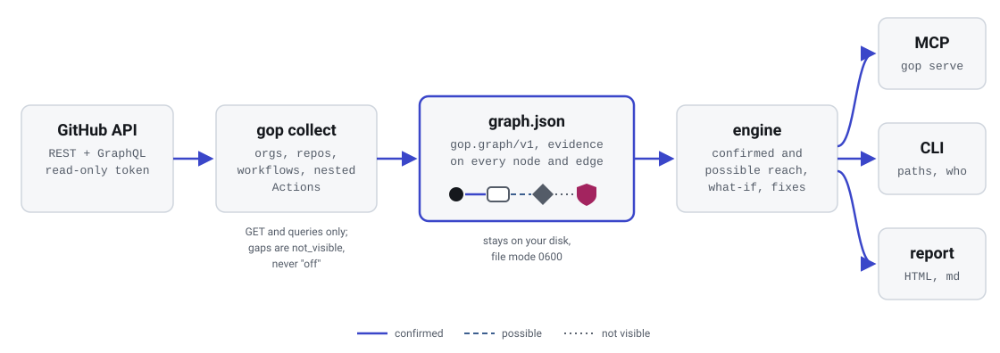

# gop: GitHub Enterprise Org Posture

**Who can make code run where in your GitHub Enterprise.** gop maps an enterprise as an evidence graph and answers questions like: *members of acme-actions (default permission Write, 2FA not required) can push code that runs in 12 repos across 2 orgs, including a workflow with cloud OIDC. Which one change removes most of that?*

[](https://github.com/peleduri/gop/actions/workflows/ci.yml)
[](https://scorecard.dev/viewer/?uri=github.com/peleduri/gop)
[](https://goreportcard.com/report/github.com/peleduri/gop)
[](LICENSE)
[](https://github.com/peleduri/gop/releases)

gop is read-only. It joins org settings (default repository permission, 2FA, SSO), push access, workflows and the Actions they consume, including Actions nested inside composite Actions, and follows reach across org boundaries: members of one org push to a shared Action, and that Action runs inside another org's workflows with that org's secrets, OIDC trust and runners. You query the graph from an AI agent over MCP, from the CLI, or from a GitHub Action that builds an HTML report.

## 10-second demo

Real output from the synthetic enterprise in [`testdata/acme/graph.json`](testdata/acme/graph.json), trimmed where marked `...`:

```console
$ gop paths --graph testdata/acme/graph.json --from members:acme-actions
members:acme-actions has confirmed paths to 29 nodes; 0 more possible

Confirmed (every hop live or audit) (29):
  ...
  members:acme-actions -> oidc:acme-app/web  [confirmed]
      members:acme-actions =[CAN_PUSH, live]=> repo:acme-actions/deploy  source: rest:/orgs/{org}
      repo:acme-actions/deploy =[RESOLVES_TO (reversed), live]=> action:acme-actions/deploy@main  source: contents:.github/workflows
      action:acme-actions/deploy@main =[USES (reversed), live]=> workflow:acme-app/web/.github/workflows/ci.yml  source: contents:.github/workflows
      workflow:acme-app/web/.github/workflows/ci.yml =[EXECUTES_WITH, live]=> oidc:acme-app/web  source: contents:.github/workflows
  ...

$ gop report --graph testdata/acme/graph.json --out - --format md
> Members of acme-actions can push code that runs in 12 repos across 2 orgs (confirmed), including 1 cloud OIDC trust, 1 secret scope, 1 self-hosted runner pool.
>
> Pin acme-actions/deploy@main to a commit SHA in every workflow that uses it to remove 72% of confirmed reach.
...
| # | Fix | Confirmed pairs removed | Cumulative removed |
|---:|---|---:|---:|
| 1 | Pin acme-actions/deploy@main to a commit SHA in every workflow that uses it | 18 | 72% |
| 2 | Lower the default repository permission of acme-actions to read | 4 | 88% |
| 3 | Pin acme-actions/deploy@v1 to a commit SHA in every workflow that uses it | 1 | 92% |
...

$ gop who --graph testdata/acme/graph.json --target secret:acme-legacy/old-api
0 principals can control secret:acme-legacy/old-api (confirmed); 1 more possible through a not visible hop

Possible (at least one hop not visible) (1):
  members:acme-legacy -> secret:acme-legacy/old-api  [possible: a hop is not visible]
      members:acme-legacy =[CAN_PUSH, not visible]=> repo:acme-legacy/old-api  source: rest:/orgs/{org}
      ...
```

The last answer is the point of the tool: the token could not read acme-legacy's repositories, so gop reports a *possible* path, not "no path".

To record this yourself with [vhs](https://github.com/charmbracelet/vhs): `vhs docs/demo.tape`.

## The nested-action trap

In the demo fixture, pinning `deploy@main` is the right first fix. Change one detail and it stops working. In the collector's end-to-end fixture ([`internal/collect/testdata`](internal/collect/testdata)), `acme-actions/deploy` is a composite Action whose first step is `uses: acme-actions/setup@main`:

1. Members of acme-actions (default permission Write) can push to `acme-actions/setup`.
2. `setup@main` runs inside every `deploy`, including in acme-secure, which pins `deploy` to a full commit SHA.
3. Pinning `acme-actions/deploy@main` to a SHA removes **0** of the acme-actions members' confirmed (principal, repo) pairs: whoever controls `setup` still controls every `deploy` consumer. (It does cut reach for bob and erin, whose direct grants cover `deploy` only, and for the `platform` team and its child team `platform-oncall`, whose grant covers `deploy` only.)
4. gop's fix planner picks pinning `deploy@main` first (23 of 64 confirmed pairs, 36%), because of those direct and team grants, then **lowering acme-actions' default permission to read** (12 more pairs), the only fix that cuts the members' reach. The rest comes from org owners and other direct and team grants, which neither fix touches.
5. Reproduce it: `go test ./internal/collect -run TestEndToEndAcme -v`.

gop counts a SHA pin as blocking a path only when the whole nested chain under it is immutable.

`gop demo` plants the same trap: `acme-secure/signer` pins `acme-actions/release` to a SHA, but `release` calls `acme-actions/setup@main`. `gop demo | gop report --graph - --out - --format md` lists it under "Pinned, still reachable", and `what_if` pinning `deploy@main` leaves that path in place.

## Why gop

Good tools already cover GitHub security. Most of them answer "is this repo or org configured well?" or "is this workflow file safe?". gop answers a different question: across every org in the enterprise, **who can make code run where, and through which hops?**

| | Checks | Scope | Output | Examples |
|---|---|---|---|---|
| Posture checklists | Org and repo settings against best practice | One repo or one org at a time | Pass/fail findings | [OpenSSF Scorecard](https://github.com/ossf/scorecard), [Legitify](https://github.com/Legit-Labs/legitify), ghqr, gitsec |
| Workflow linters | Dangerous patterns in workflow files: injection, `pull_request_target`, unpinned refs, broad permissions | Workflow files | Findings per file and line | [zizmor](https://github.com/zizmorcore/zizmor), [poutine](https://github.com/boostsecurityio/poutine), [actionlint](https://github.com/rhysd/actionlint) |
| Offensive tooling | What an attacker holding a token can exploit: runners, pwn requests, secrets | What one token can reach | Attack paths for red teams | [Gato-X](https://github.com/AdnaneKhan/gato-x) |
| **gop** | Who can push code that ends up running in which repo's CI, with which secrets, OIDC trusts and runners | The whole enterprise, across orgs and nested Actions | A graph with evidence on every hop, confirmed vs possible reach, and the fewest changes that remove the most reach | |

Use them together. A linter tells you a workflow is unsafe; Scorecard tells you a repo lacks branch protection; gop tells you that the members of another org can change what that workflow runs. gop does not lint workflow contents for injection, and it is not an exploitation tool.

## Try it without a token

`gop demo` writes a synthetic enterprise (`acme`, orgs `acme-*`, users `alice`, `bob`, `user-NNN`) with no token and no network. It plants the cross-org `acme-actions/deploy@main` path, a SHA-pinned consumer that is safe, a SHA-pinned composite action that is not (it calls `acme-actions/setup@main` inside), one hop the token cannot see in `acme-legacy`, and a self-hosted runner.

```sh
go install github.com/peleduri/gop/cmd/gop@latest
gop demo | gop report --graph - --out - --format md   # the headline, fixes, and "Pinning is not enough"
claude mcp add gop -- gop serve --demo                # then ask: who can make code run in acme-app/web?
```

`gop demo [--size small|medium|large] [--seed N] [--out graph.json]` writes the graph (stdout by default); `small` is about 60 repos, `medium` about 1,000, `large` about 10,000. The same size and seed give a byte-identical file. `gop serve --demo` and `gop report --demo` build the small graph in memory. Demo graphs say so: the enterprise node carries `demo=true`, every `source_api` starts with `demo:`, and every MCP summary and report title starts with `[demo data]`.

## Quick start

```sh
go install github.com/peleduri/gop/cmd/gop@latest                  # or Homebrew / a signed release, see Install
GITHUB_TOKEN=... gop collect --enterprise acme --out graph.json     # read-only, see "Token and permissions"
gop report --graph graph.json --out report.html                     # or ask your agent, below
```

No enterprise handy? Every read command works on the fixture: `--graph testdata/acme/graph.json`.

### Connect your agent (MCP over stdio)

Claude Code:

```sh
claude mcp add gop -- gop serve --graph /path/to/graph.json
```

Cursor, VS Code and other clients: [docs/mcp-clients.md](docs/mcp-clients.md). `gop mcp-config --client claude|cursor|vscode --graph graph.json` prints the config with the absolute path filled in. Use an absolute path, and keep the graph out of shared or synced folders.

Then ask: "Who can make code run in acme-app/web?", "What happens if we pin acme-actions/deploy@main to a SHA?", or "What couldn't the token see?"

### MCP tools

Every tool is annotated read-only, and every answer keeps confirmed and possible reach apart.

| Tool | Answers |
|---|---|
| `who_can_reach` | Which principals can make code run in a target repo, workflow, action, secret scope, OIDC trust or runner pool, with one shortest path each. |
| `blast_radius` | Everything one principal (an org's members, a user, a team, an app) can make code run in, with a score. |
| `paths` | The concrete hops from a principal, optionally to one target, each with its edge kind, evidence level and API source. |
| `top_risks` | Principals ranked by confirmed blast radius. |
| `what_if` | Reach before and after hypothetical fixes: `pin_ref` (pin an action to a SHA) or `lower_default_perm` (set an org's default permission to read or none). |
| `suggest_fixes` | A greedy plan: the fixes that remove the most confirmed (principal, repo) pairs, with the cumulative percentage. |
| `fix_plan` | Concrete change steps for one fix (`fix`, or `suggestion_rank` from `suggest_fixes`): every workflow line to edit with a one-line diff, or the org setting with its REST call as text. gop never runs the steps. |
| `explain` | Why an edge exists: evidence, `source_api`, `observed_at` and attributes. |
| `coverage` | What the token could not see, and the access that would make it visible. |
| `diff` | What changed since a baseline snapshot (`gop serve --graph new.json --baseline old.json`): new and removed paths, settings, edges, score deltas and coverage, filterable by principal and target kind. Same report as `gop diff --format json`; lost visibility is never reported as a fix. |

### CLI

```
gop collect --enterprise <slug> --out graph.json [--orgs a,b]
gop doctor  --enterprise <slug> [--github-url URL] [--orgs a,b] [--format text|json]
gop demo    [--size small|medium|large] [--seed N] [--out graph.json]
gop serve   --graph graph.json | --demo  [--baseline old.json]
gop report  --graph graph.json | --demo  --out report.html [--format html|md] [--top N]
gop paths   --graph graph.json --from <principal> [--to <node>]
gop who     --graph graph.json --target <node>
gop validate --graph graph.json [--format text|json]
gop diff    OLD.json NEW.json [--format text|json|markdown] [--fail-on confirmed-increase|any-new-path]
gop fix-plan --graph graph.json --pin <action> | --lower-default-perm <org> [--to read|none] [--format text|markdown|json]
gop pin     --action <owner/repo@ref> [--graph graph.json [--repo owner/repo] [--offline]] [--github-url URL] [--format diff|text|json]
gop mcp-config --client claude|cursor|vscode --graph graph.json
gop version
```

`gop fix-plan` turns a fix into a checklist: for `--pin action:acme-actions/deploy@main`, every workflow and nested action that uses the ref, sorted by repo and file, with the line and a one-line diff when the graph has line attributes; for `--lower-default-perm org:acme-actions`, the setting with its UI path and REST call, and the repos where members lose push. Markdown output pastes into a ticket. gop never runs the steps or calls write APIs.

`gop pin --action acme-actions/deploy@main` resolves the ref to its commit SHA with one read-only call (`GET /repos/{owner}/{repo}/commits/{ref}`), says whether the ref is a tag or a branch (tags can move too), and prints the replacement `uses:` value. With `--graph`, it also fetches each consuming workflow file (read-only) and prints a unified diff per file that applies with `git apply`; use `--repo acme-app/web` to get one repo's part, then `gop pin ... --repo acme-app/web | git apply` in that checkout. `--offline` skips the file reads and prints the one-line hunks `fix-plan` shows. It warns when the action itself uses mutable refs, since pinning the outer ref does not close those. The token comes from `GITHUB_TOKEN` (or `GH_TOKEN`); gop pin sends only GET requests and writes to stdout only. To keep pins current afterwards, use Dependabot or Renovate.

`gop diff` compares two snapshots and reports posture drift: new and removed paths, setting changes, score deltas and coverage gaps. Facts the newer token cannot see are reported as lost visibility, never as removed. See [docs/drift.md](docs/drift.md).

`--graph -` reads the graph from stdin for `report`, `paths` and `who`. Node IDs look like `members:acme-actions`, `identity:bob`, `repo:acme-app/web`, `action:acme-actions/deploy@main`, `oidc:acme-app/web`. An unknown ID returns suggestions.

## No half truths

Every node and edge in the graph carries an evidence level:

| Evidence | Meaning |
|---|---|
| `live` | Read from current state through the GitHub API. |
| `audit` | Inferred from the enterprise audit log. Retention is bounded, so it may be stale or incomplete. The schema and engine support it; the collector does not read the audit log yet (planned). |
| `not_visible` | The token cannot read this fact. The hop is **unknown, not absent**. |

gop never turns "couldn't see" into "off". A path with any `not_visible` hop is **possible** reach and is never counted in headline numbers, scores or fix suggestions. A path where every hop is `live` or `audit` is **confirmed**. The `coverage` list says what was missing and the access that would close the gap, for example "org owner on acme-legacy (SSO enforced: join through the identity provider first)".

How the engine reasons, briefly: push access controls a repo; a repo controls the workflows defined in it and every Action it hosts on a mutable ref (a branch, a tag, or a ref gop could not classify: it never assumes a pin it did not see); an Action controls every workflow and composite Action that uses it; a controlled workflow runs in its repo's CI with that workflow's secrets, OIDC token and runners. Running CI in a repo is counted as reach, not as push access to it. The rules are documented at the top of [`internal/graph/reach.go`](internal/graph/reach.go).

## What gop collects today

- Enterprise orgs, default repository permission, 2FA and SSO policy, and org settings: member repo creation, visibility changes, repo deletion, private forks, IP allow lists.
- Org membership counts and the repositories of each org.
- `CAN_PUSH` from an org's members to every repo in that org when the default repository permission is Write or Admin.
- `identity:` nodes for licensed users with `MEMBER_OF` their orgs, and `CAN_PUSH` from org owners (every repo in the org), direct collaborators and outside collaborators with push (including custom repository roles). When a repo's collaborators can't be listed, license-listed repo grants become `not_visible` (possible) edges.
- `team:` nodes with nested teams (`MEMBER_OF` the parent team), direct team members (`MEMBER_OF` the team), and `CAN_PUSH` from each team repository grant with push. Members of a child team reach the parent's repos through the nesting. A non-owner token can't see secret teams; that gap is recorded in coverage.
- Workflow files: the Actions and reusable workflows they use, `id-token: write`, secrets and self-hosted runners. Composite Actions and reusable workflows are expanded recursively at the referenced ref.

Not collected yet (planned): GitHub App grants, org-level custom roles, enterprise teams, audit log facts, branch protection and environment rules, a GitHub Enterprise Server endpoint flag, and resumable collection.

## Install

```sh
brew install peleduri/tap/gop                         # Homebrew (tap coming soon, see docs/install.md)
go install github.com/peleduri/gop/cmd/gop@latest     # from source
# or a signed archive from Releases: https://github.com/peleduri/gop/releases
```

Release archives are signed keyless with cosign and ship with SPDX SBOMs and SLSA build provenance. Checksum, signature and provenance steps, plus a "verify what you run" checklist, are in [docs/install.md](docs/install.md).

## Token and permissions

gop only reads, and it takes the token only from `GITHUB_TOKEN` (or `GH_TOKEN`), never as a flag. Use a classic token from an **enterprise owner** with these scopes, or the equivalent read permissions on a GitHub App:

| Scope | Used for | If missing |
|---|---|---|
| `read:enterprise` | Enterprise ownerInfo: org list, enterprise-level default permissions, 2FA and SSO policy, membership | Enterprise settings are `not_visible`; orgs come from `--orgs`, or are discovered only where the token is a member (`GET /user/orgs`) or installed (`GET /installation/repositories`) |
| `read:org` | Org settings, repositories, IP allow lists | That org's settings and `CAN_PUSH` edges are `not_visible` |
| `repo` | Workflow and action file contents in private and internal repositories (`USES`, `EXECUTES_WITH` edges) | Workflows in those repos are `not_visible`, so cross-org paths through them are unknown |
| `read:audit_log` | Facts that only the audit log records (planned, not used yet) | No `audit` evidence |

Under SAML SSO enforcement the token must also be authorized for each org.

Before a long first collection, run `GITHUB_TOKEN=... gop doctor --enterprise acme`. In a handful of read-only requests it reports the token kind and mode (below), missing or broader-than-needed scopes, a classic token with no expiry, orgs where the token is not authorized for SSO, the remaining REST and GraphQL budget, an estimate of requests and minutes for `collect`, and what will come out `not_visible`, each with the fix. It never prints the token. Exit 0 all pass, 1 any fail, 3 warnings only. The token kind comes from GitHub's documented prefixes (`ghp_`, `github_pat_`, `ghs_`, ...); fine-grained and App permissions are not exposed in headers, so doctor cannot check them.

### Token modes

| Mode | What gop sees |
|---|---|
| (a) Enterprise-owner token, run locally | Full enterprise settings plus every org and repo the owner can see. **The intended mode.** |
| (b) Per-org GitHub App installation tokens | No enterprise ownerInfo: enterprise settings collectors are skipped and marked `not_visible`, and gop collects per org: the `--orgs` list, or the owners of the installation's repositories. Settings the org API returns (`GET /orgs/{org}`: default permission, 2FA, repo creation, private forks) stay `live`; SSO is `not_visible`. Members come from the org members API. An `uses:` owner outside the collected orgs gets `in_enterprise=unknown`, not "outside". The App must be installed in every org you want covered; uninstalled orgs are `not_visible`. In CI the App private key is itself a high-value credential. |
| (c) A repository's `GITHUB_TOKEN` | One repository only. gop is not useful in this mode. |

### Rate limits

A token gets 5,000 REST requests per hour (GitHub Apps scale with installation size). Large enterprises take a while to collect. Collection is sequential today; it retries transient errors and waits out rate limits. Resuming an interrupted collection is planned.

## Running in GitHub Actions: token risk

The Action (`uses: peleduri/gop/action@<sha>`) downloads a release, verifies its checksum (and cosign signature when cosign is installed), runs `gop collect` and `gop report`, and uploads both files as an artifact.

```yaml
permissions:
  contents: read
jobs:
  posture:
    runs-on: ubuntu-latest
    steps:
      - uses: peleduri/gop/action@<full-commit-sha> # vX.Y.Z
        with:
          enterprise: acme
          token: ${{ steps.app-token.outputs.token }}
          retention-days: 1
```

Read this before you set it up:

- **Prefer a read-only GitHub App installation token per org**, minted per run, over a PAT. An enterprise-owner PAT stored in Actions secrets creates exactly the high-value CI path gop reports: anyone who can change a workflow in that repository can use it.
- With App tokens, enterprise settings and any org the App is not installed in show as `not_visible` in the report (mode b above). The App private key in secrets is a high-value credential; keep it in a dedicated private repository with restricted workflow edit access.
- **Artifacts are readable by anyone with read access to the repository.** graph.json and report.html are an attack map. Run the Action only in a **private** repository, and keep `retention-days` at 1 (the default).
- For full coverage, run gop locally with an enterprise-owner token (mode a) instead.

## Security and privacy

- **Read-only.** gop makes no write calls to GitHub.
- **No telemetry.** gop sends nothing anywhere except read requests to the GitHub API.
- **Data stays local.** graph.json and the report are written to your disk with file mode 0600. Treat them as sensitive and never commit them.
- **MCP answers go to your agent.** When you connect `gop serve` to an agent, its answers flow to that agent and to whichever model provider it uses. gop itself sends nothing anywhere.

See [docs/threat-model.md](docs/threat-model.md) and [docs/schema.md](docs/schema.md). Report vulnerabilities through [SECURITY.md](SECURITY.md).

## Architecture



`gop collect` writes one JSON document (`gop.graph/v1`, [schema](docs/schema.md), [JSON Schema](schema/gop.graph.v1.schema.json); check a file with `gop validate`). Everything else reads that file: the engine indexes it once and answers reach, scoring, what-if and fix-planning queries for the MCP server, the CLI and the report. The fix planner is a budgeted greedy over grouped fixes, not an exact min-cut, and it never suggests a fix whose edges are all `not_visible`.

## Roadmap

Planned, roughly in order. Each item will get a [GitHub issue](https://github.com/peleduri/gop/issues); comment there if you need it.

- Team and GitHub App push grants
- Audit log collection (`audit` evidence)
- Branch protection, rulesets and environment protection as conditions on edges
- `what-if` and `fix` CLI subcommands (available over MCP today)
- A GitHub Enterprise Server endpoint flag
- Resumable and parallel collection
- Diff between two collections

## Contributing

Issues and PRs are welcome. Read [CONTRIBUTING.md](CONTRIBUTING.md) first: commits need a DCO sign-off, and all fixtures, examples and issues use synthetic names only (`acme`, `acme-actions`, `acme-app`). Never paste a real graph.json anywhere. Report security issues through [SECURITY.md](SECURITY.md). Changes are tracked in [CHANGELOG.md](CHANGELOG.md).

## Status

Alpha. The graph schema (`gop.graph/v1`) and CLI flags may change before v1.0.

## License

[Apache-2.0](LICENSE)
