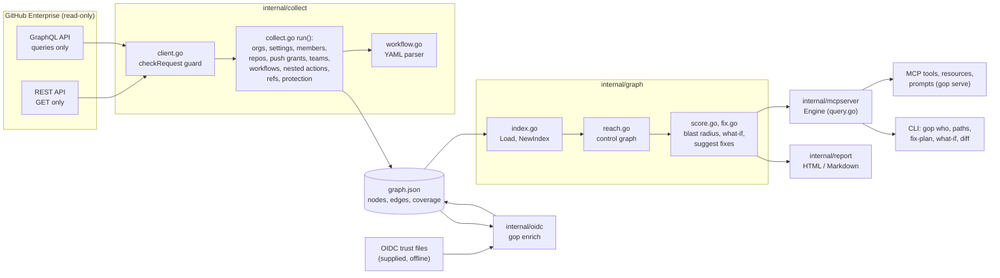

# Architecture

A map of gop for contributors. Read it before your first change: gop's model
(evidence levels, a control graph with reversed hops, confirmed vs possible
reach) is precise, and most review comments come from breaking one of the
[invariants](#invariants) below.

gop does four things in order:

1. **collect**: read a GitHub Enterprise through REST and GraphQL (read-only)
   and write an evidence graph, `graph.json`.
2. **graph**: load `graph.json`, derive the control graph and answer reach
   questions (who can reach X, what can P reach, which fix removes the most).
3. **engine**: turn graph answers into text and JSON that keep confirmed and
   possible reach apart.
4. **surfaces**: the MCP server, the CLI (`gop who`, `gop paths`, ...) and the
   HTML or Markdown report all call the same engine.

## Package map

| Package | What lives there |
|---|---|
| [`cmd/gop`](../cmd/gop) | The CLI. [`main.go`](../cmd/gop/main.go) dispatches subcommands (`collect`, `doctor`, `enrich`, `demo`, `serve`, `report`, `paths`, `who`, `validate`, `diff`, `mcp-config`, `fix-plan`, `what-if`, `pin`, `sarif`). Each subcommand parses flags and calls a library package; no analysis logic lives here. |
| [`internal/collect`](../internal/collect) | Everything that talks to GitHub. [`client.go`](../internal/collect/client.go) is the HTTP client: retries, rate limits and the read-only guard (`checkRequest`). [`collect.go`](../internal/collect/collect.go) is the collector: `run` calls each collector step in order and `graph()` sorts nodes and edges into the output. One file per fact family: [`teams.go`](../internal/collect/teams.go), [`protection.go`](../internal/collect/protection.go), [`refs.go`](../internal/collect/refs.go), [`actionsaccess.go`](../internal/collect/actionsaccess.go), [`triggers.go`](../internal/collect/triggers.go), [`token.go`](../internal/collect/token.go), [`batch.go`](../internal/collect/batch.go) (GraphQL file reads). [`workflow.go`](../internal/collect/workflow.go) is the workflow and composite-action parser (no network). [`doctor.go`](../internal/collect/doctor.go) and [`doctor_app.go`](../internal/collect/doctor_app.go) predict what a token or GitHub App will leave `not_visible`. |
| [`internal/graph`](../internal/graph) | The model and the analysis. [`types.go`](../internal/graph/types.go) is the schema contract shared by every package (node and edge kinds, evidence levels, attribute keys, `SchemaVersion`). [`index.go`](../internal/graph/index.go) loads a graph and builds sorted adjacency lists. [`reach.go`](../internal/graph/reach.go) derives the control graph and runs reach (`Reach`, `WhoCanReach`). [`score.go`](../internal/graph/score.go) is the blast radius score. [`fix.go`](../internal/graph/fix.go) holds the fix types, `WhatIf`, `Candidates` and the greedy `SuggestFixes`. [`access.go`](../internal/graph/access.go) is the Actions "Access" gate and [`coverage.go`](../internal/graph/coverage.go) summarizes `not_visible` facts per org. |
| [`internal/mcpserver`](../internal/mcpserver) | The query engine and the MCP server. [`query.go`](../internal/mcpserver/query.go) is `Engine`: one method per question, shared by MCP and the CLI. [`server.go`](../internal/mcpserver/server.go) registers the tools, [`resources.go`](../internal/mcpserver/resources.go) the `gop://` resources and [`prompts.go`](../internal/mcpserver/prompts.go) the prompts in [`prompts/`](../internal/mcpserver/prompts). [`text.go`](../internal/mcpserver/text.go) prints paths for the CLI. |
| [`internal/report`](../internal/report) | `Render` writes one self-contained HTML file ([`html.go`](../internal/report/html.go), [`assets.go`](../internal/report/assets.go)) or Markdown ([`markdown.go`](../internal/report/markdown.go)) from the data built in [`data.go`](../internal/report/data.go). |
| [`internal/fixplan`](../internal/fixplan) | Turns a graph fix into concrete change steps (workflow lines to edit, settings to change). Used by `fix_plan` and `gop fix-plan`. |
| [`internal/whatif`](../internal/whatif) | Re-scores the graph with hypothetical fixes: before and after pair totals, the paths that disappear and the top paths that remain. Used by `what_if` and `gop what-if`, so both report the same numbers. |
| [`internal/oidc`](../internal/oidc) | Parses exported AWS, GCP and Azure OIDC trust files and matches them to workflow tokens (`gop enrich`). Offline only. |
| [`internal/advisory`](../internal/advisory) | Loads OSV GitHub Actions advisories (a local `all.zip` or directory, or the OSV API with `--advisories-live`) and marks affected action refs (`advisories`, `advisory_severity`, `advisory_fixed`) for `gop collect` and `gop enrich`. Never talks to GitHub. See [advisories.md](advisories.md). |
| [`internal/cartography`](../internal/cartography) | Reads the rows of a user-run Cartography query into OIDC trusts and observed role use for `gop enrich`. Offline only. |
| [`internal/sarif`](../internal/sarif) | Turns fixable edges into SARIF 2.1.0 results (`gop sarif`). |
| [`internal/diff`](../internal/diff) | Compares two graph snapshots (`gop diff`, the `diff` MCP tool). |
| [`internal/schema`](../internal/schema) | Validates `graph.json` against [`schema/gop.graph.v1.schema.json`](../schema/gop.graph.v1.schema.json) (`gop validate`). |
| [`internal/demo`](../internal/demo) | Generates a deterministic synthetic enterprise (`gop demo`). |
| [`internal/testutil`](../internal/testutil) | Golden file helper (`go test ./... -update`). |
| [`docs/schema.md`](schema.md) | Node ID conventions and edge semantics. Embedded by [`docs/docs.go`](docs.go) and served as `gop://graph/schema`. |

## Data flow



`graph.json` is the only interface between collection and analysis. Everything
after it runs offline, so every analysis feature can be tested on a hand-made
fixture such as [`testdata/acme/graph.json`](../testdata/acme/graph.json).

## The control graph

The evidence graph records facts as GitHub reports them (`repo -DEFINED_IN->
workflow` reads "the workflow is defined in the repo"). The control graph is
derived from it and is directed controller to controlled: an attacker who holds
the left side gains the right side. Some evidence edges are reversed on the way
(code pushed to a repo changes its workflows, so `DEFINED_IN` is followed from
repo to workflow).

The source of truth is the comment above `controlGraph` in
[`internal/graph/reach.go`](../internal/graph/reach.go). The block below is a
verbatim copy; [`docs/docs_test.go`](docs_test.go) fails when the two differ,
so change the comment in `reach.go` first and then paste it here.

<!-- control-graph-rules:begin -->
```text
principal -CAN_PUSH->     repo       push access controls the repo
identity  -MEMBER_OF->    members:X  an identity gets what all members of X get
repo      -DEFINED_IN->   workflow   (reversed) code pushed to a repo changes its workflows
workflow  -DEFINED_IN->   repo       a controlled workflow runs in that repo's CI. The repo
                                     is counted as reached ("CI reach") but NOT expanded:
                                     running CI is not the same as being able to push.
workflow  -CAN_PUSH->     repo       ...unless the workflow's GITHUB_TOKEN has contents: write
                                     (via=token_write): then the workflow can push to its repo,
                                     so this is a full control hop like any CAN_PUSH and the
                                     repo is expanded. A not_visible edge (default workflow
                                     permissions not readable) makes that control possible.
                                     The token can't edit .github/workflows/, but workflows run
                                     repo code, so DEFINED_IN (reversed) still expands. A
                                     RestrictToken fix drops the workflow's token_write edges.
repo      -RESOLVES_TO->  action     (reversed) pushing to the host repo changes the action,
                                     only when the ref is mutable (branch or tag). A sha ref
                                     (or a PinRef fix) blocks this hop. Branch protection
                                     gates it through the action's ref_protected attr:
                                       true:    no repo -> action hop. Instead each CAN_PUSH
                                                edge into the host repo with via=ref_bypass
                                                and ref equal to the action's ref becomes a
                                                principal -> action hop. When bypass=unknown
                                                the repo -> action hop stays, not_visible.
                                       unknown: the repo -> action hop is not_visible, so the
                                                path is possible, never confirmed.
                                       false or missing: the hop is unchanged.
                                     A tag (node ref_kind=tag) is gated the same way
                                     through ref_immutable instead (an immutable release
                                     or a tag ruleset blocking update and deletion), with
                                     ref_bypass edges whose ref is the tag. A ref with
                                     ref_ambiguous=true (both a tag and a branch) is not
                                     gated at all: the more mutable reading wins.
                                     Only this hop is gated. DEFINED_IN stays unconditional:
                                     a push to any unprotected branch runs that branch's copy
                                     of an on: push workflow with the repo's secrets.
action    -USES->         workflow   (reversed) whoever controls an action's content controls
action    -USES->         action     every workflow or composite action that uses it. This
                                     hop ignores the ref: a sha-pinned action that itself USES
                                     a nested branch/tag action stays controllable through the
                                     nested one. A sha pin only blocks a path when the whole
                                     nested chain is immutable. The only gate is the host
                                     repo's actions_access (Actions "Access" setting), checked
                                     against the consumer's repo by actionsAccessAllows: a
                                     disallowed hop is dropped, and an unknown setting makes a
                                     cross-org hop not_visible. No attr: the hop is unchanged.
                                     A USES edge from a workflow with actions_lock=locked is
                                     dropped: the repo's actions.lock pins the action and every
                                     nested ref under it to commits, so changing the action does
                                     not change what the workflow runs. actions_lock=stale
                                     changes nothing.
principal -CAN_TRIGGER->  workflow   the principal can cause a risky trigger (pull_request_target,
                                     workflow_run, issue_comment, ...) of a workflow that runs
                                     attacker-controlled code: a forward control hop like CAN_PUSH.
                                     The workflow is controlled, so its EXECUTES_WITH terminals are
                                     reached, its repo counts as CI reach, and a via=token_write
                                     CAN_PUSH expands to the repo. A HardenTrigger fix drops
                                     every CAN_TRIGGER edge into its workflow.
principal -CAN_MERGE_VIA_BOT-> repo  the principal can open a pull request that the repo's
                                     workflows approve and merge with a bot token the default
                                     branch's rules let through: a forward control hop like
                                     CAN_PUSH (the repo is controlled). A BlockBotMerge fix
                                     drops every CAN_MERGE_VIA_BOT edge into its repo.
workflow  -EXECUTES_WITH-> secret|oidc|runner   terminal impact
workflow  -CAN_ASSUME->   cloud_target  terminal impact: a token the workflow mints matches a
                                     supplied cloud trust policy (gop enrich --oidc-trust). The
                                     hop starts at the workflow, not at the repo's shared oidc
                                     node, because each workflow's own claims (environments,
                                     job_workflow_ref) decide the match. Evidence supplied counts
                                     as confirmed and sets Path.Supplied; an undecided match is
                                     not_visible, so possible.
```
<!-- control-graph-rules:end -->

A path is **confirmed** when every hop is `live`, `audit` or `supplied`, and
**possible** when at least one hop is `not_visible`. Node IDs and the meaning
of every edge kind and attribute are in [`docs/schema.md`](schema.md).

## Invariants

Every change must keep these. Reviewers check them first.

1. **Read-only toward GitHub.** Product code only sends GET requests and
   GraphQL queries (plus the GitHub App installation-token POST, which mints a
   read-only token). `checkRequest` in
   [`internal/collect/client.go`](../internal/collect/client.go) refuses
   anything else before a request leaves the process; do not widen it. GraphQL
   mutations are refused too.
2. **Every fact has evidence and a source.** Every node and edge carries an
   evidence level (`live`, `inferred` for facts derived by a documented rule
   named in `attrs.rule`, `audit`, `not_visible`, or `supplied` for facts read
   from user-supplied files) and every edge a `source_api` that names the call
   it came from. Per-attribute evidence goes in `attr_evidence` when it differs
   from the node's.
3. **`not_visible` never becomes "off".** When the token cannot read
   something, record `not_visible` and a `coverage` entry that says which
   access would make it visible (`k.cover` in the collector). Never default a
   setting to its safe value, never drop the edge, and never print "disabled"
   for something gop could not read.
4. **Confirmed and possible are never summed.** Headline numbers, scores
   (`Score` vs `PossibleScore`), what-if deltas and report sentences count
   confirmed reach only. Possible reach is shown next to it, labelled. Fixes
   whose edges are all `not_visible` are never suggested.
5. **Deterministic output.** The same input gives byte-identical output:
   nodes and edges are sorted (`graph()` in `collect.go`, `NewIndex` in
   `index.go`), map iteration never reaches output unsorted, and timestamps
   come from the graph or an injected clock. Golden tests depend on this.
6. **Synthetic data only.** This is a public repository. Fixtures, tests,
   docs, issues and commit messages use enterprise `acme`, orgs `acme-*`
   (`acme-actions`, `acme-app`) and users like `alice` and `bob`. Tests never
   call the real GitHub API: use the `httptest` fakes in
   [`internal/collect/server_test.go`](../internal/collect/server_test.go).
7. **Schema compatibility.** A breaking change to the serialized graph bumps
   `graph.SchemaVersion` in [`types.go`](../internal/graph/types.go) and
   updates [`docs/schema.md`](schema.md) and
   [`schema/gop.graph.v1.schema.json`](../schema/gop.graph.v1.schema.json).
   Adding an optional attribute is not breaking.

## How to add a collector

A collector reads one more fact family from GitHub and adds nodes, edges,
attributes or coverage entries to the graph.

- [ ] Add the constants (node kind, edge kind, attribute keys and values) to
      [`internal/graph/types.go`](../internal/graph/types.go) and describe them
      in [`docs/schema.md`](schema.md) and
      [`schema/gop.graph.v1.schema.json`](../schema/gop.graph.v1.schema.json).
- [ ] Write the step in a new file under
      [`internal/collect/`](../internal/collect), as a `(*collector)` method in
      the style of [`actionsaccess.go`](../internal/collect/actionsaccess.go):
      a doc comment naming every endpoint it calls, `k.node` / `k.edge` /
      `setAttr` for facts (each with an evidence level and a `source_api`), and
      `k.cover` for every read that fails or is refused.
- [ ] Call it from `run` in
      [`internal/collect/collect.go`](../internal/collect/collect.go) at the
      point where its inputs exist, and report progress if it is slow.
- [ ] Use GET or a GraphQL query only. If you need a new GraphQL query, batch
      it like [`batch.go`](../internal/collect/batch.go).
- [ ] If the fact needs a token permission, teach
      [`doctor.go`](../internal/collect/doctor.go) (and
      [`doctor_app.go`](../internal/collect/doctor_app.go) for App mode) to
      predict it as `not_visible` when the permission is missing.
- [ ] Extend the fake GitHub in
      [`server_test.go`](../internal/collect/server_test.go) and the synthetic
      fixture [`testdata/acme.json`](../internal/collect/testdata/acme.json),
      including a refused (403) case that must produce `not_visible` plus a
      coverage entry.
- [ ] Run `go test ./internal/collect -update` and review the diff of
      [`testdata/golden/collect_acme.json`](../internal/collect/testdata/golden/collect_acme.json).
- [ ] If the new fact changes reach, update the rules in `reach.go` (and the
      copy above) and add a property in
      [`property_test.go`](../internal/graph/property_test.go).

## How to add an MCP tool

- [ ] Add the question to `Engine` in
      [`internal/mcpserver/query.go`](../internal/mcpserver/query.go): an
      `XxxInput` and `XxxOutput` struct (with `json` and `jsonschema` tags; the
      schema text is what the agent sees) and a method
      `func (e *Engine) Xxx(in XxxInput) (XxxOutput, error)` with a one-line
      `Summary` field that keeps confirmed and possible apart.
- [ ] Resolve node arguments with `e.resolve` so unknown IDs get suggestions.
- [ ] Register it in `NewServerWith` in
      [`server.go`](../internal/mcpserver/server.go) with `addTool`, which
      marks every tool read-only and idempotent. The description says what the
      tool answers, not how.
- [ ] Add tests in [`server_test.go`](../internal/mcpserver/server_test.go)
      and a golden in [`golden_test.go`](../internal/mcpserver/golden_test.go)
      (`testdata/golden/`), then `go test ./internal/mcpserver -update`.
- [ ] If the CLI should answer the same question, call the engine from a
      subcommand in [`cmd/gop`](../cmd/gop) rather than reimplementing it.
- [ ] List the tool in the README and, if a prompt should use it, in
      [`prompts/`](../internal/mcpserver/prompts).

## How to add a fix type

A fix is one grouped hypothetical change with cost 1 that removes or blocks
control edges.

- [ ] Add the type to [`internal/graph/fix.go`](../internal/graph/fix.go):
      a struct implementing `Fix` (`ID`, `apply`, `edges`), a flag in
      `fixSet`, and the check in the control-graph build in
      [`reach.go`](../internal/graph/reach.go) that drops the edges it removes.
      Update the rules comment in `reach.go` and the copy above.
- [ ] Add it to `Candidates` (fix.go) if `suggest_fixes` should consider it,
      and to the `FixEdges` doc comment.
- [ ] Teach the property tests the reference reading of the fix
      (`refFixes` and `refControl` in
      [`property_test.go`](../internal/graph/property_test.go)), and make the
      random graph generator in [`gen_test.go`](../internal/graph/gen_test.go)
      produce the edges it changes.
- [ ] Map it to and from its JSON form: `Spec` and `Build` in
      [`internal/fixplan/fixplan.go`](../internal/fixplan/fixplan.go) (with a
      `buildXxx` that writes concrete steps, see
      [`workflow.go`](../internal/fixplan/workflow.go)) and `toFix`,
      `fixTypes` and `fixShapes` in
      [`internal/mcpserver/query.go`](../internal/mcpserver/query.go).
- [ ] Document the shape in the `what_if` description in
      [`server.go`](../internal/mcpserver/server.go) and the `fix_plan` tool in
      [`fixplan.go`](../internal/mcpserver/fixplan.go), and add a flag to
      [`cmd/gop/fixplan.go`](../cmd/gop/fixplan.go).
- [ ] Add goldens under `internal/fixplan/testdata/golden/` and
      `internal/mcpserver/testdata/golden/`, then `go test ./... -update`.
