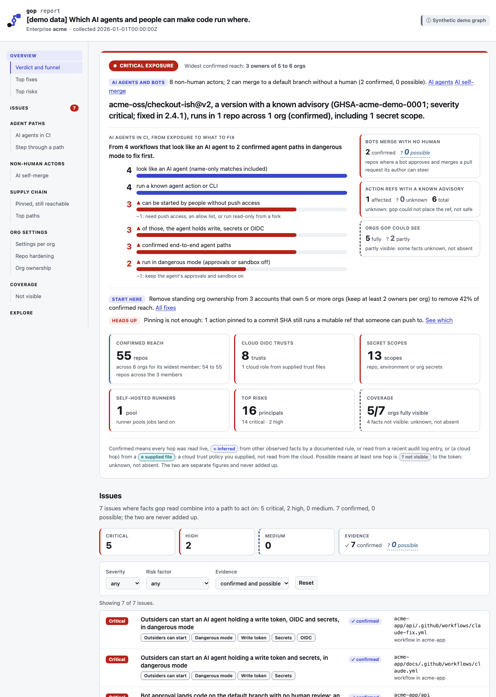

# The HTML report: `gop report`

```sh
gop report --graph graph.json --out report.html
gop report --graph new.json --previous old.json --out report.html   # opens with what changed
```

The report is one self-contained HTML file: an inline style, the embedded graph data and one inline script, all pinned by a Content Security Policy (`default-src 'none'` plus the SHA-256 of the style and of the script, computed from the constants in `internal/report/assets.go`). It loads nothing from the network and works offline. Every section is server-rendered, so it reads the same with JavaScript off; the script adds the filters and the per-org views. `--format md` writes the same content as Markdown.

## Layout



The report reads top to bottom, most important first. Light and dark themes follow the system setting (`prefers-color-scheme`); printing uses a light A4/Letter layout with every path expanded and each hop's source API written out.

- **Verdict.** The posture (critical, high or moderate exposure: the worst severity in the top risks, mapped from confirmed impact the same way as `gop sarif`), the headline sentence, the first fix and six figures: confirmed repos and orgs, cloud OIDC trusts, secret scopes and self-hosted runner pools of the principal with the widest confirmed reach, the number of top risks, and coverage (orgs with no coverage gap). A possible figure ("+3 repos possible") sits under its confirmed one, muted and dashed, and is never added to it. With no confirmed reach the verdict reads "No confirmed reach, but gop could not see everything" whenever there is possible reach or a coverage gap; only a graph with neither reads "No confirmed reach found".
- **Top fixes.** The greedy picks as ranked cards: the fix, its fix ID, a one-line reason from the fix's shape, the engine's caveat when it has one, and a bar with this fix's share of the baseline confirmed (principal, repo) pairs on top of the earlier fixes' share (lighter), plus the cumulative share.
- **Top risks.** Rank, principal, impact (the severity of confirmed reach, labelled "High impact" so it is not confused with an advisory's own severity), confirmed repos and orgs, an impact bar of confirmed cloud roles, OIDC trusts, secrets and runner pools (each number is also written out), possible reach and score. Advisory and poutine markers sit under the principal. A principal with possible reach only reads "possible only", never "low".
- **What gop could not see.** Coverage gaps grouped by the access that closes them ("Org owner needed on 2 orgs"), then every gap with its reason.
- **Pinned, still reachable** and **Top paths.** Each path is a hop chain, `principal → repo → workflow → target`, collapsed by default. Every hop shows its edge kind and evidence badge; hovering or focusing it shows the source API (and "reversed" when the evidence edge points the other way). Long commit SHAs are cut to 12 characters in the chip, with the full ID as its title. A path into an org with weak or unknown SSO or IP allow list carries the "Context, not part of the score" note above its chain. The chain stacks vertically on narrow screens.
- **Org settings.** A heat grid of every org setting column: strong (✓), weak (!) or unknown (?). SSO enforced, 2FA required, IP allow list on and default permission read or none are strong; a member capability left on (create, delete, fork or change visibility of repos) is weak; member counts are neutral. An unknown cell links to its "Why unknown" entry and shows the reason and the access that fixes it on hover.
- **Repo hardening.** When the graph has repo hardening facts: a heat grid per org of protected default branch, required reviews, CODEOWNERS covering workflows, secret scanning and push protection (✓ every repo, ! some repos lack it, ? some repos unknown), the repos on the top paths with their effective protection, and advisory hardening suggestions. A path with a `CAN_PUSH` hop into such a repo carries a second "Context, not part of the score" note ("push needs 2 approvals to reach `main`"). See [Repo hardening](#repo-hardening).
- **Explore paths.** The filters, the List and Graph tabs and the org views, as before.

Screenshots of the demo report: [light](assets/report-light.png), [dark](assets/report-dark.png), [390 px](assets/report-narrow.png), [print](assets/report-print.png), [hop chains](assets/report-paths.png), [org settings and hardening context](assets/report-settings.png).

## Repo hardening

When the graph has repo hardening facts (`gop collect` records them, see [docs/schema.md](schema.md#repo-hardening)), the report gets a "Repo hardening" section after the org settings:

- one row per org: its non-archived repos with hardening facts, and for each of protected default branch, required reviews, CODEOWNERS covering `.github/workflows/`, secret scanning and push protection, `yes/total`, with repos gop could not read counted as `(N unknown)`, never as off;
- the repos the top principals push to on a confirmed path, each with its effective protection and its source (`protected (ruleset:7), 2 approvals, force push blocked; CODEOWNERS covers workflows; secret scanning on, push protection off`);
- advisory hardening suggestions (require reviews, enable push protection), which are not counted as removing confirmed reach.

`CAN_PUSH` hops in the top paths carry the same notes as the MCP tools ("push needs 2 approvals to reach `main`", "push reaches the default branch directly"). The section and the notes are context only: the headline, scores, counts and fix ranking do not change.

## What changed: `--previous`

With `--previous old.json`, gop runs the same comparison as `gop diff old.json new.json` and puts a "What changed" banner at the top:

- the dates of the two snapshots and `gop diff`'s own one-sentence summary, verbatim;
- the top principal's score before and after;
- one group per kind of change, each with an exact count and up to 10 items:
  - **New confirmed paths**: `added` pairs whose new path is confirmed, plus `upgraded` (possible → confirmed) pairs.
  - **Removed paths**: `removed` pairs, each marked with what it was (confirmed or possible).
  - **New possible paths**: `added` pairs with a hop that is not visible.
  - **Setting changes**: settings that changed or became visible.
  - **Lost visibility**: paths that lost visibility or were downgraded to possible, settings that are no longer visible, and coverage gaps that opened. These are unknown, not fixed.

Each path item links to the filtered view for its principal (for example `#ev=confirmed&kind=oidc&q=identity%3Abob`), and each setting or coverage item links to its org view (`#/org/acme-app`). The links need JavaScript. `gop diff` lists every change, including the edge changes the banner leaves out.

`--previous` refuses the snapshots `gop diff` refuses: another enterprise or another major schema version (exit 2). Without `--previous` the report has no banner.

The GitHub Action passes `--previous` when `fail-on-reach-increase` downloaded a baseline. If the baseline cannot be compared, the Action writes the report without the banner.

## Org settings and hardening context

The **Org settings** section has one row per org: SSO, 2FA, IP allow list, default permission, the member capabilities (create, change visibility of and delete repositories, fork private repositories) and the member count. The values are the org attributes gop already records (see [schema.md](schema.md#attributes)); the section adds no claim of its own. When an org owner token could read them, the IP allow list cell also shows the number of active entries and whether the list applies to installed GitHub Apps, for example `on (2 active entries, installed apps on)`. Entry values (IP ranges) are never collected.

A setting gop could not see reads `unknown`, never `off` or `none`. Each `unknown` links to a **Why unknown** list under the table that gives, per org, the coverage reason and the access that fixes it (for example "not visible: token is not an org owner. Access that fixes it: org owner on acme-legacy"), or says the setting was not collected in this graph.

In **Top paths**, a confirmed or possible path whose target repo's org has SSO not enforced or an IP allow list that is not on gets a context line, for example "Context, not part of the score: target org acme-actions: SSO not enforced (configured), IP allow list off". A stolen token is more useful against such an org. An unknown setting reads `unknown`, and a path into an org with SSO enforced and the IP allow list on gets no line. The line is context only: evidence levels, confirmed and possible counts, scores and rank order are the same with or without it. The `paths`, `who_can_reach` and `explain` MCP tools (and `gop paths`, `gop who`) carry the same context as `target_org_hardening: {org, sso, ip_allow_list}` on each such path, and `top_risks` lists the weak or unknown target orgs of the principals it returns. The `gop://graph/summary` resource and the SQL export's `org_settings` view hold the same per-org settings as the table.

## Graph tab

Under "Explore paths", the **Graph** tab draws the paths that match the current filters as one left-to-right diagram: principals on the left, then repos, action refs and workflows, and the impact (OIDC, secrets, runners, cloud roles, CI reach into repos) on the right. `#view=graph` in the address opens it, together with any filter (`#org=acme-app&view=graph`).

- **Layout.** gop computes it in Go over the union of every embedded path: each node's layer is its longest path from a principal, and the order inside a layer comes from barycenter sweeps that reduce crossings. Any subset of the paths keeps every hop pointing right, so the script only hides nodes and closes empty layers. No layout engine or third-party library runs in the browser.
- **Hops.** Each hop is drawn in control direction. Solid is live, dashed is audit, dotted grey with a `?` is not visible (unknown, not absent), dash-dot is a supplied file. An evidence class this gop build does not know (from a newer schema) is a thin grey line and keeps its own name in the details, never "not visible". Hovering a hop, or focusing a node, shows the evidence edge's `source_api`, `observed_at` and attrs (with `file:line` when known). A reversed hop (`DEFINED_IN`, `RESOLVES_TO`, `USES` traversed backwards) says the evidence edge points the other way.
- **Select a node.** Click a node, or Tab to it and press Enter or Space, to keep only the paths through it (the "Through node" filter, saved in the address as `via=`). Select it again to clear.
- **Simulate a pin.** When the view holds a mutable action ref that is one of the top 10 suggested fixes, "Simulate a pin" greys the paths that pin removes. The removed paths are computed by the Go engine (`WhatIf` with that fix alone) and embedded; the script does no reachability. A confirmed path is removed when its target is no longer confirmed for its principal, a possible path when its target is no longer reached at all.
- **Cap.** The graph draws at most 300 nodes. Above that it says "Too many paths to draw" and asks you to narrow the filter; the list view still works.

## Accessibility

The report must work with a screen reader and a keyboard, and must never say "confirmed" or "possible" with color alone: that difference is the core of gop.

| Check | How the report meets it | Tested by |
|---|---|---|
| Landmarks | One `header` (the `h1` and the snapshot line), one `nav` labelled "Report sections", one `main`, one `footer`, and a "Skip to the report" link. | `TestA11yStructure` |
| Headings | Exactly one `h1`; headings never skip a level going down (`h1` → `h2` → `h3` → `h4`), in the static report, the banner and the org views. | `TestA11yStructure` |
| Tables | Every table has a `caption` (visually hidden when a heading already names it) and `th scope="col"` headers (the org settings grid also has `th scope="row"`). Tables built by the script go through one helper that adds both. | `TestA11yStructure`, `TestScriptRendersAccessibleMarkup`, `TestInlineScriptInNode` |
| Form controls | Every filter (the selects, the principal search box, the org checkboxes) is inside a `label`; the org checkboxes are grouped in a `fieldset` with a `legend`. | `TestA11yStructure` |
| Keyboard | Only native links, buttons, form controls and `details` are interactive, plus each hop of a path chain and each unknown org setting (`tabindex="0"`, to show the source API or the reason), and the Graph tab's nodes (`tabindex="0"`, `role="button"`, `aria-pressed`, Enter or Space selects). There is no positive `tabindex`, and focus has a visible outline in both themes. The List and Graph tabs follow the ARIA tabs pattern (arrow keys, Home, End). Following a banner link moves focus to the filtered paths; opening an org view moves focus to its heading; selecting a graph node keeps focus on it. | `TestA11yStructure`, `TestScriptRendersAccessibleMarkup`, `TestInlineScriptInNode` |
| Evidence not by color | Every evidence badge is text plus an icon hidden from screen readers: `✓ confirmed`, `? possible: a hop is not visible`, `✓ live`, `≈ inferred`, `✓ audit`, `≡ supplied file`, `? not visible`, `? unknown`, and `• <name>` for an evidence class this build does not know. Severity pills, heat-grid cells and the verdict carry their word ("Critical", "! write", "? not visible"), not only a color; impact bars are decorative and their numbers are written next to them. In the Graph tab, hop styles (solid, dashed, dotted with `?`) differ by line pattern, not only color, and the text alternative names each hop's evidence. | `TestA11yStructure`, `TestInlineScriptInNode` |
| Contrast | Every text color on every background it is used on is at least 4.5:1 (WCAG AA) in the light theme, the dark theme (`prefers-color-scheme: dark`) and print, including the severity, tag and heat-grid colors. | `TestContrastAA` |
| Live results | The filter result count ("12 paths match (9 confirmed, 3 possible) ...") is a `role="status"` region with `aria-live="polite"`, so screen readers announce it after each filter change. | `TestA11yStructure` |
| Graph image | The Graph tab's SVG has `role="group"`, an `aria-label` with its node and path counts, and `aria-describedby` pointing at "Paths in this graph, as text": an ordered list of every drawn path with each hop's kind and evidence, and which paths a simulated pin removes. The draw status (node, hop and path counts, or the cap message) is a polite live region. Any server-rendered SVG must have the same role, name and text alternative. | `TestA11yStructure`, `TestScriptRendersAccessibleMarkup`, `TestInlineScriptInNode` |

The tests parse the rendered HTML with `golang.org/x/net/html` (`internal/report/a11y_test.go`, `internal/report/banner_test.go`). For a manual check, open a report in a browser and run axe DevTools or the Lighthouse accessibility audit, in both color schemes.
